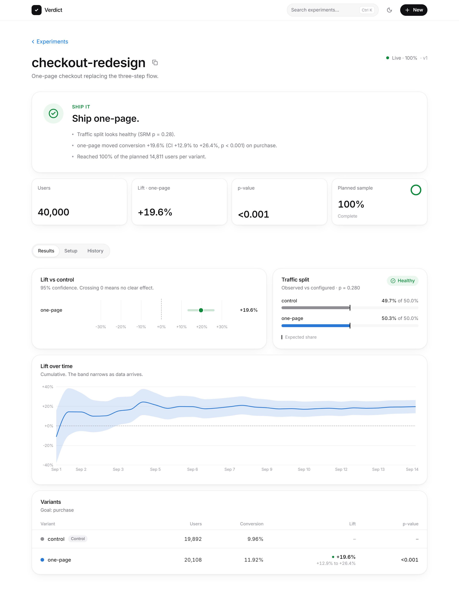
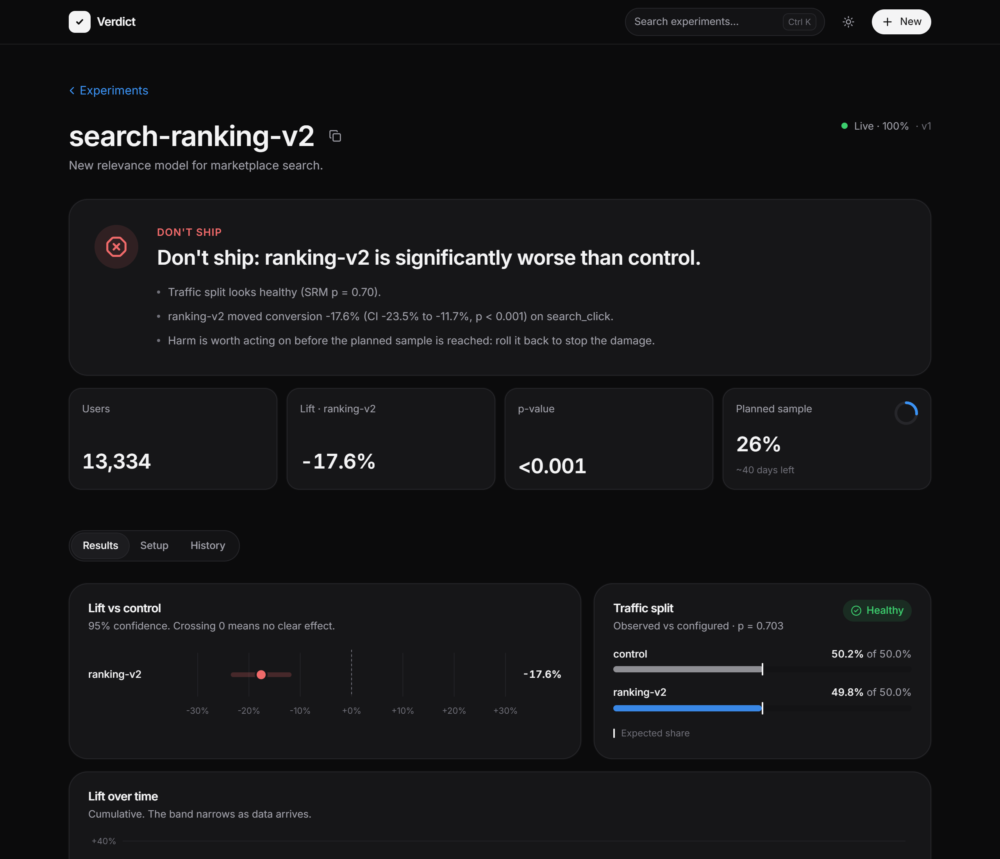
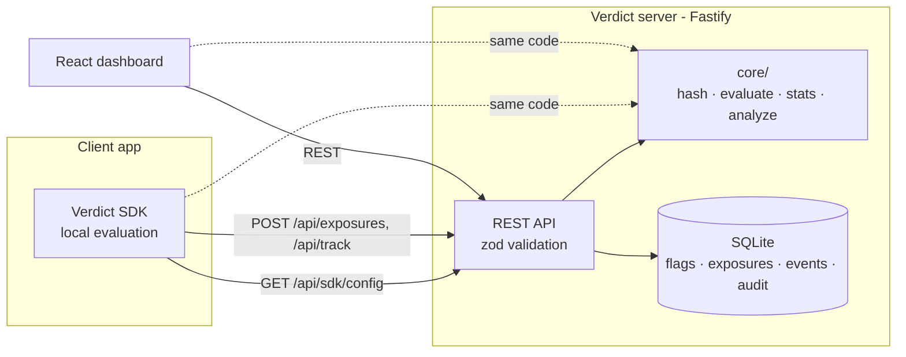

# Verdict

**A self-hosted feature flag and A/B testing platform that tells you whether to ship.**

[](https://github.com/josephfanpm/verdict/actions/workflows/ci.yml)


**Try it:** [run locally in 3 commands](#getting-started) · [Docker](#getting-started) · deploy your own with [`render.yaml`](render.yaml)
<!-- TODO(Joseph): add a hosted demo URL here if you deploy one (Render free tier is already configured). -->

Most experimentation tools show p-values and leave the call to you. Verdict makes the call: **Ship it**, **Don't ship**, **Keep running**, **No difference**, or **Investigate**, with the reasons written out.


---

## Problem

Running an A/B test is three jobs: ship a flag, route traffic to the right variant, and decide what the numbers mean. Teams usually get the first two right and fumble the third.

| Failure | What happens | Cost |
|---|---|---|
| **Peeking** | Someone checks on day 2, sees p = 0.03, and ships | In 2,000 simulated A/A tests, stopping at the first p < 0.05 gives **25.1%** false positives vs **5.5%** checking once ([`npm run peeking`](scripts/peeking.ts)) |
| **Broken splits** | A variant crashes before logging an exposure, so its users vanish | The test shows a lift that doesn't exist |
| **Mid-test edits** | Weights change from 50/50 to 90/10 halfway through | Two populations get blended into one result |

Dashboards that only report significance answer "is p < 0.05 right now?", which is the wrong question. Verdict builds the guardrails into the default path.

## Target users

- **PMs** who own a ship/no-ship decision and need a clear answer with reasons, not a stats table.
- **Engineers on small teams** who want flags and experiments without a vendor contract or a database to run. Verdict is one Node process with built-in SQLite.

<!-- TODO(Joseph): add any real user evidence (teams who tried it, feedback) if you have it. None is claimed here. -->

## Solution

| | |
|---|---|
| **Decision engine** | Turns counts into a verdict and plain-English reasons ([`analyze.ts`](src/core/analyze.ts)) |
| **Trust checks first** | Sample Ratio Mismatch (SRM) test on every experiment before any lift is read |
| **Sample-size gate** | Plans users per variant from the minimum detectable effect (MDE); won't call a win early |
| **Change guardrails** | API returns HTTP 409 on edits that would bias a running test, unless you force a restart |
| **Feature flags** | On/off, % rollouts, attribute targeting, multi-variant splits |
| **Deterministic bucketing** | MurmurHash3 into 10,000 buckets; same user, same variant, everywhere, nothing stored |
| **Clean counting** | First exposure wins; conversions only count if they happen after exposure |
| **Audit log** | Every change versioned with a readable diff |
| **TypeScript SDK** | Local evaluation, batched exposure tracking |
| **Dashboard** | Verdict first, details second: confidence-interval plot, cumulative lift over time, traffic-split health, ⌘K search, light and dark themes |



The case that matters most: the `checklist` variant shows a significant **+8.1%** lift, and a p-value dashboard would say ship. Verdict sees `video-tour` is missing 1.6 points of its expected traffic (p = 4.9e-7), so the data is broken, and it refuses to call it.


<details>
<summary>Dark mode</summary>



</details>

### How it decides

Checks run in this order. The order is the product.

1. **No exposures** → *Not started*.
2. **SRM** (chi-square p < 0.001) → *Investigate*. A broken split makes every lift number untrustworthy.
3. **A treatment is significantly worse** (and none is better) → *Don't ship*, even before the planned sample.
4. **A treatment is significantly better**
   - every variant at planned sample → *Ship it*
   - sample incomplete → *Keep running*, with a peeking warning
5. **No significant difference at full sample** → *No difference*: ship whichever is cheaper to maintain.
6. Otherwise → *Keep running*, with progress toward the planned sample.

Planned sample comes from the control's observed rate, the MDE, 80% power, and alpha. Alpha is 0.05, Bonferroni-divided across treatments. No sample is planned until control has 100 exposures.

## My role

I built Verdict with Claude Code as a pair programmer. I set the product direction: the problem, the guardrails, the order of checks in the decision engine, and the bar that every statistical claim is tested against a published reference value. I reviewed and tested the implementation until I could explain every line. The full story is in [docs/article.md](docs/article.md).

## Key decisions and trade-offs

| Decision | Options | Chose | Gave up | Why |
|---|---|---|---|---|
| **Output** | p-value dashboard · opinionated verdict | Verdict + reasons | Flexibility for expert readers who want to apply their own rules | The failure is in the judgment call, not the math. Reasons keep the call auditable. |
| **Statistical approach** | Fixed-horizon frequentist · sequential (mSPRT) | Fixed-horizon z-test, gated by planned sample size | Valid continuous monitoring; teams wait for the full sample to call a win | Most widely understood. The sample-size gate enforces the horizon. mSPRT is the named next step. |
| **Asymmetric stopping** | Same rule for wins and losses · stop early on harm | Harm → *Don't ship* immediately; wins wait | Early harm calls are exposed to the same peeking error the win rule avoids | Waiting for statistical purity while real users get a worse experience is a bad trade. |
| **SRM gate** | Report SRM as a warning · block the verdict | Block: *Investigate* overrides any lift | A real lift stays hidden until the split is fixed | A broken split invalidates the comparison. Threshold p < 0.001 so the always-on check rarely cries wolf ([`stats.ts`](src/core/stats.ts)). |
| **Mid-test edits** | Allow · warn · block | Block with 409; `?force=true` restarts with a new salt and discards data | Convenience; forced edits lose collected data | The safe path is the default; the unsafe path is explicit and logged. Raising rollout stays allowed. |
| **Multiple variants** | No correction · Bonferroni | Bonferroni | Power: more treatments need more users per arm | Simple and conservative. The corrected alpha also feeds the sample-size plan, so the gate stays consistent. |
| **Architecture** | Separate logic per surface · one pure core | Pure `src/core` shared by server, SDK, dashboard | Some structure overhead | SDK and server can't disagree on bucketing; the planner can't disagree with the verdict. A test asserts it. |
| **Storage** | Postgres · SQLite, results on read | Node built-in SQLite, computed on read | Scale; real volume would need pre-aggregation | Zero setup for anyone cloning it. All SQL lives in one `Store` class. |

<!-- TODO(Joseph): if you weighed Bayesian methods (probability to beat control), add a line on why fixed-horizon frequentist won. The repo doesn't record that comparison, so it isn't claimed above. -->

**Known gaps:** when one treatment wins and another is significantly worse, the engine recommends the winner and doesn't call out the loser in the headline ([`analyze.ts`](src/core/analyze.ts)). There are no guardrail metrics yet: a test is judged on one primary metric.

## Success metrics

**Measured (from the repo):**

| What | Result | Source |
|---|---|---|
| Peeking cost, 2,000 A/A tests | 25.1% false positives with peeking vs 5.5% checking once | [`scripts/peeking.ts`](scripts/peeking.ts) |
| SRM catch in demo data | 7% exposure loss in one arm flagged at p = 4.9e-7, over a "significant" +8.1% lift | [`src/server/demo.ts`](src/server/demo.ts), screenshot above |
| Verdict coverage | One test per verdict branch, including "significant but under-powered" and "great lift, broken split" | [`test/analyze.test.ts`](test/analyze.test.ts) |
| Test suite | 51 tests in about 1 second; CI on every push to `main` | [`ci.yml`](.github/workflows/ci.yml) |
| Demo seeding | 5 experiments, ~100k simulated users, under 1 second | `npm run simulate` |

**KPIs I would track in production (proposed, not measured):**

| KPI | Why |
|---|---|
| % of experiments ending in a decision (Ship / Don't ship / No difference) | Is the tool producing calls, or stalling in *Keep running*? |
| Median days from launch to decision | Cost of the sample-size gate |
| Share of Ships reached at full sample | Peeking discipline actually held |
| SRM rate per 100 experiments | Instrumentation health |
| Forced (`force=true`) edits per experiment | Are the edit guardrails respected or routinely bypassed? |

<!-- TODO(Joseph): add real usage numbers here if Verdict has run on real traffic. None are claimed. -->

## Roadmap

| | Item | Why |
|---|---|---|
| **Now** | Dashboard redesign: verdict-first layout, confidence-interval plot, cumulative lift over time | Built on the `ui-redesign` branch, not yet merged |
| **Next** | Sequential testing (mSPRT) | Removes the main cost of the fixed horizon: waiting to call a win |
| **Next** | Guardrail metrics ("ship unless latency regresses") | Today one primary metric decides; a win can hide harm elsewhere |
| **Next** | Continuous metrics (revenue per user): t-test plus winsorizing | Event table already stores a `value` |
| **Later** | CUPED variance reduction | Shorter tests at the same power |
| **Later** | Pre-aggregated counts, Postgres | Only needed at real scale |
| **Later** | Scheduled ramp-ups, per-environment SDK keys | Operational polish |

No RICE scores: there's no usage data to estimate reach honestly.

## Technical overview



- **Stack:** TypeScript (strict), Fastify + zod, Node 22 `node:sqlite`, React + Vite + Tailwind v4 + Radix, Vitest, GitHub Actions, Docker.
- **Statistics by hand:** z-test, delta-method CIs, sample size, and a chi-square distribution (regularized incomplete gamma) with no stats library, so every number traces to a formula. Tested against published table values. See [`stats.ts`](src/core/stats.ts).
- **Two independent hashes:** one decides *whether* a user is in, one decides *which* variant. Ramping 10% → 50% only adds users. See [`evaluate.ts`](src/core/evaluate.ts).
- **Bugs the tests caught:** SDK exposures timestamped on the server made every conversion look like it came first, so it was dropped; per-variant rounding left 1 in 10,000 users unbucketed. Both now have regression tests ([article](docs/article.md)).

Full reference (code layout, API, SDK, statistics, test coverage): **[docs/TECHNICAL.md](docs/TECHNICAL.md)**.

## Getting started

Requires **Node.js 22.13+**. No database to install.

```bash
git clone https://github.com/josephfanpm/verdict.git
cd verdict
npm install
npm run simulate   # seed 5 demo experiments
npm run dev        # API on :3000, dashboard on http://localhost:5173
```

Production build: `npm run build && npm start` (http://localhost:3000).
Docker: `docker build -t verdict . && docker run -p 3000:3000 verdict` (seeds the demo automatically).

API, SDK usage, and admin-token setup: [docs/TECHNICAL.md](docs/TECHNICAL.md).

## License

MIT. See [LICENSE](LICENSE).
