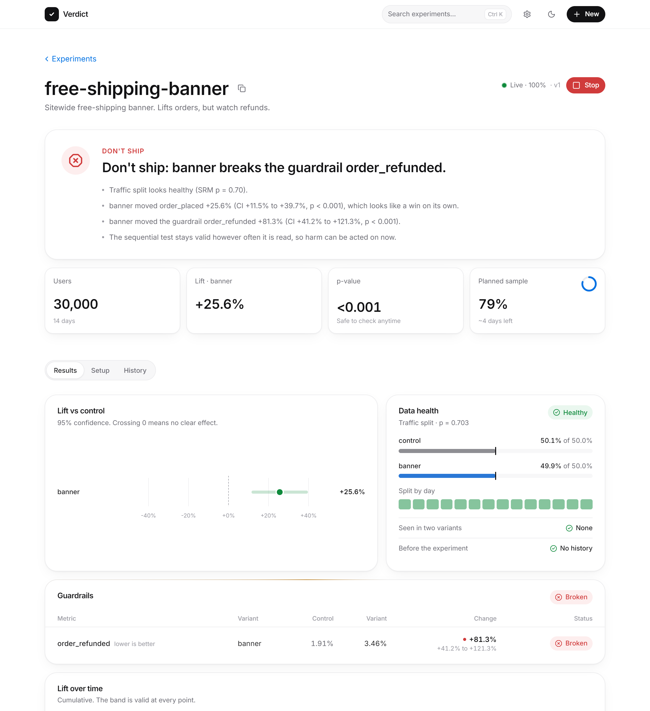
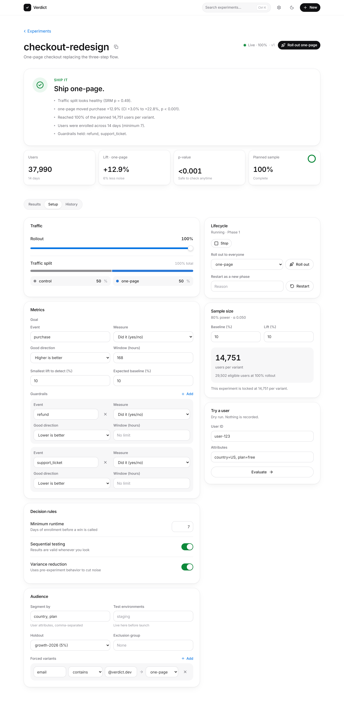
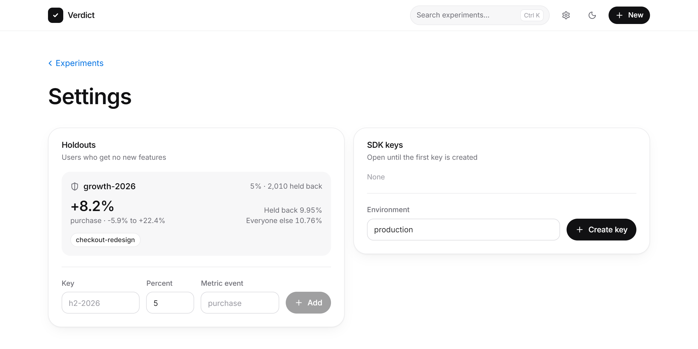
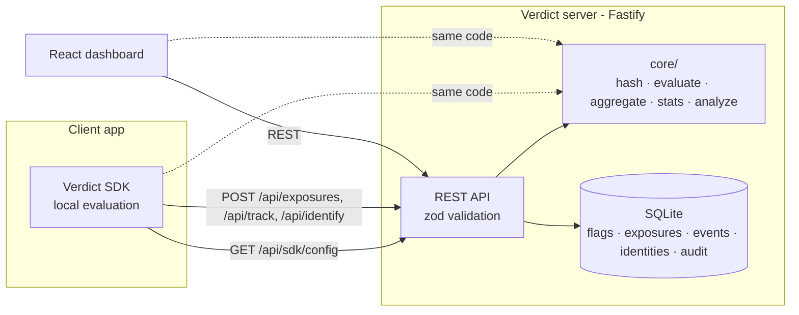

# Verdict

**A self-hosted feature flag and A/B testing platform that tells you whether to ship.**

[](https://github.com/josephfanpm/verdict/actions/workflows/ci.yml)


**Try it:** [run locally in 3 commands](#getting-started) · [Docker](#getting-started) · deploy your own with [`render.yaml`](render.yaml)

## Live demo

**Live demo:** https://verdict-u0xb.onrender.com

The repo is already set up for one click deploy on Render's free tier, using the `render.yaml` blueprint at the repo root (Docker web service named `verdict`, free plan, health check `/api/health`). The Dockerfile sets `SEED_DEMO=true`, so a fresh deploy seeds 8 demo experiments and a holdout automatically.

To deploy it:

1. Create a free account at Render, or sign in with GitHub.
2. Open the deploy page: [](https://render.com/deploy?repo=https://github.com/josephfanpm/verdict)
3. Give Render access to the `josephfanpm/verdict` repo, keep branch `main` and blueprint path `render.yaml`, and click Apply.
4. Wait for the build, roughly 4 to 12 minutes on the free plan. The service URL will look like `https://verdict.onrender.com` (Render assigns the exact hostname; do not guess it, copy it from the Render dashboard).
5. Open the URL and check `/api/health` returns `{"ok": true}`. The dashboard should show the 8 seeded demo experiments.
6. The demo is live at https://verdict-u0xb.onrender.com

Two free tier notes: the instance sleeps after 15 minutes without traffic, so the first load can take about 50 seconds while it wakes up; and the free disk is ephemeral, so the demo data re-seeds on every restart and any changes made in the demo are lost. That is fine for a portfolio demo, and it is why the demo always starts from the same seeded experiments.

GitHub Pages cannot host this demo: the React dashboard calls the Fastify API on the same server (`/api/flags`, `/api/health`), and Pages serves static files only, with no Node server or SQLite database.

Most experimentation tools show p-values and leave the call to you. Verdict makes the call: **Ship it**, **Don't ship**, **Keep running**, **No difference**, or **Investigate**, with the reasons written out.


---

## Problem

Running an A/B test is three jobs: ship a flag, route traffic to the right variant, and decide what the numbers mean. Teams usually get the first two right and fumble the third.

| Failure | What happens | Cost |
|---|---|---|
| **Peeking** | Someone checks on day 2, sees p = 0.03, and ships | In 2,000 simulated A/A tests, stopping at the first p < 0.05 gives **25.1%** false positives vs **5.5%** checking once ([`npm run peeking`](scripts/peeking.ts)) |
| **Broken splits** | A variant crashes before logging an exposure, so its users vanish | The test shows a lift that doesn't exist |
| **Mid-test edits** | Weights change from 50/50 to 90/10 halfway through | Two populations get blended into one result |
| **One-metric wins** | Orders go up, and so do refunds | The "win" ships and costs more than it earns |
| **Moving finish lines** | The sample target is recomputed from the data as it arrives | The test ends when the numbers happen to look good |

Dashboards that only report significance answer "is p < 0.05 right now?", which is the wrong question. Verdict builds the guardrails into the default path.

## Target users

- **PMs** who own a ship/no-ship decision and need a clear answer with reasons, not a stats table.
- **Engineers on small teams** who want flags and experiments without a vendor contract or a database to run. Verdict is one Node process with built-in SQLite.

<!-- TODO(Joseph): add any real user evidence (teams who tried it, feedback) if you have it. None is claimed here. -->

## Solution

| | |
|---|---|
| **Decision engine** | Turns the data into a verdict and plain-English reasons ([`analyze.ts`](src/core/analyze.ts)) |
| **Trust checks first** | Traffic split (overall, by day, by segment), users seen in two variants, and a pre-experiment balance check, all before any lift is read |
| **Goal and guardrails** | One metric decides; any number of guardrail metrics can veto |
| **Metric types** | Yes/no conversion, value per user (revenue), and ratios (revenue per order), with conversion windows and outlier capping |
| **Safe to check anytime** | Sequential testing keeps false positives under 5% however often results are read |
| **Locked sample plan** | Users per variant is fixed once, from a stated or observed baseline, plus a minimum runtime in days |
| **Less noise** | Pre-experiment behavior is used to shrink the confidence interval (CUPED) |
| **Lifecycle and phases** | Draft → running → stopped or rolled out → archived. A restart opens a new phase and keeps the old data |
| **Change guardrails** | API returns HTTP 409 on edits that would bias a running test, unless you force a restart |
| **Feature flags** | On/off, % rollouts, attribute targeting, forced variants, multi-variant splits, variant payloads |
| **Mutual exclusion and holdouts** | Tests that would collide never share users; a held-back group measures what shipping added up to |
| **Deterministic bucketing** | MurmurHash3 into 10,000 buckets; same user, same variant, everywhere, before and after login |
| **Clean counting** | First exposure wins; conversions only count after exposure and inside the window; retried events never count twice |
| **Environments and SDK keys** | Staging traffic never reaches the analysis; SDKs get only what evaluation needs |
| **Audit log** | Every change versioned with a readable diff |
| **TypeScript SDK** | Local evaluation, batched tracking with retry, and an OpenFeature provider |
| **Dashboard** | Verdict first, details second: guardrails, data health, segments, lift over time, lifecycle controls, ⌘K search, light and dark themes |

A clear call: the goal is up, both guardrails held, the split is healthy, and the test ran its full sample and two full weeks.


A win that isn't one: orders are up 25.6%, which would ship on its own. Refunds are up 81%, so the verdict is *Don't ship*.



The case that matters most: the `checklist` variant shows a significant lift, and a p-value dashboard would say ship. Verdict sees `video-tour` is missing traffic, points at the segment where it went missing (Safari), and refuses to call it.


<details>
<summary>Setup: metrics, decision rules and audience</summary>



</details>

<details>
<summary>Holdouts and SDK keys</summary>



</details>

<details>
<summary>Dark mode, with a revenue-per-user goal</summary>


</details>

### How it decides

Checks run in this order. The order is the product.

1. **No exposures** → *Not started*.
2. **The data can't be trusted** → *Investigate*. Any one of:
   - the traffic split is off (chi-square p < 0.001)
   - more than 1% of users were logged in two variants
   - the groups already differed on the goal metric before the experiment began (p < 0.001)
3. **A treatment wins the goal and breaks no guardrail**
   - ready → *Ship it*. If another treatment is harmful, the headline says to drop it.
   - not ready → *Keep running*, with what is still missing.
4. **A treatment is significantly worse on the goal, or breaks a guardrail** (and nothing clean is winning) → *Don't ship*, even before the planned sample.
5. **No significant difference at the full sample and minimum runtime** → *No difference*: ship whichever is cheaper to maintain.
6. Otherwise → *Keep running*, with progress toward the plan.

"Ready" means users have been enrolled across the minimum runtime (7 days by default) and, when sequential testing is off, every variant has reached the planned sample.

Planned sample comes from the baseline, the minimum detectable effect, 80% power, and alpha. Alpha is 0.05, Bonferroni-divided across treatments. The plan is locked from a stated baseline at launch, or from the control arm once it has 1,000 users, and never recomputed after that.

### What each tool is for

Every feature exists because it changes a ship decision. This is why each one matters and how to use it.

| Tool | Why it matters | How to use it in a decision |
|---|---|---|
| **Guardrail metrics** | A change can win on the metric you chose and lose somewhere you did not look: more orders and more refunds, more clicks and more unsubscribes. | Add the metrics that must not get worse. A significant regression in any of them turns *Ship it* into *Don't ship*, and the reasons name the metric and the size of the damage. |
| **Value and ratio metrics** | Many goals are not yes/no. A change can leave the share of buyers flat and still raise what they spend. | Set the goal to value per user when the question is revenue, or to a ratio when the denominator is an event (revenue per order). Pair it with a conversion guardrail so a revenue win is not hiding fewer buyers. |
| **Outlier capping** | One customer spending 100 times the average can swing a revenue test on their own. | On by default at the 99th percentile for value metrics. Read a revenue result as "what typical users did", and lower the cap if a few accounts dominate. |
| **Conversion windows** | Without a window, users who joined early have had weeks to convert and users who joined yesterday have had a day, so the rate drifts with time, not with the treatment. | Give the goal a window that matches the behavior (72 hours for a purchase). Users still inside their window are left out until it closes, so every user is judged on the same amount of time. |
| **Minimum runtime** | Weekday and weekend users behave differently. A high-traffic test can reach its sample in two days and only ever see Tuesday. | Keep the 7-day default, or set it to your business cycle. A win is not called until enrollment spans it; harm is still acted on immediately. |
| **Sequential testing** | People look at results early. An ordinary test read daily produces a false win about one time in four. | Leave it on and check whenever you like: a result that crosses the line is valid at that moment, so strong effects ship early and harm stops early. Turn it off for a fixed-horizon test when you want maximum power and will only read once. |
| **Locked sample plan** | If the target moves with the data, the test ends when the data looks good, which is peeking by another name. | State the expected baseline at launch when you know it. Otherwise it locks from the control arm at 1,000 users. Progress and *No difference* are both judged against that fixed number. |
| **Variance reduction (CUPED)** | Much of the difference between users was there before the test: heavy buyers stay heavy buyers. That noise widens the interval and lengthens the test. | On by default; it applies itself when users have history. The lift tile shows how much noise was removed, which is roughly how much sooner the test can be called. |
| **Segment breakdowns** | An average hides where an effect comes from, and where a bug lives. | List the attributes to record (country, plan, browser). Use the breakdown to explain a result and to find the segment behind a broken split. It is exploratory: do not pick a winner from a segment without a follow-up test. |
| **Split check by day and segment** | "The split is broken" is not actionable until you know where. | When the verdict is *Investigate*, the reasons name the segment that is furthest off and, if the break is confined to some days, when it started. That is where to look for the bug or the deploy. |
| **Multiple-exposure check** | A user who saw both variants cannot be credited to either, and many of them means assignment is unstable. | A few are dropped and mentioned. Above 1% the verdict is *Investigate*: fix how users are identified before trusting any lift. |
| **Pre-experiment check** | If the groups differed before anyone saw anything, the treatment did not cause the difference. | Runs on its own when users have history. A failure means randomization or exposure logging is biased, and the result should not be used. |
| **Lifecycle and phases** | "Is this live, decided, or dead?" should not depend on memory. Deleting data on a restart destroys the evidence of what went wrong. | Start, stop, and roll out are explicit and logged. Restarting after a fix opens a new phase with fresh randomization; the earlier phase stays readable for comparison. |
| **Forced variants** | QA and stakeholders need to see a specific variant, including before launch, without polluting the data. | Add a rule such as "email contains @yourcompany.com → treatment". Matching users get that variant and are never counted. |
| **Mutual exclusion** | Two tests on the same screen interact: a user in both is responding to a combination neither test meant to measure. | Put colliding tests in one group and give each a slice of users. The API refuses overlapping slices, so no user is ever in both. |
| **Holdouts** | Ten shipped wins of +2% rarely add up to +20%. Effects overlap, fade, or were partly luck. | Keep a few percent of users on the default experience across a set of flags, then read the holdout: the gap between held-back users and everyone else is the cumulative effect of everything that shipped. |
| **Identity linking** | A visitor who converts after signing up has two ids. Unlinked, the exposure and the purchase belong to different people and the conversion is lost. | Pass the anonymous id alongside the user id. Bucketing stays on the first id so the experience does not change at login, and conversions under the account are credited to the right variant. |
| **Idempotent events** | A retried request that double-counts a purchase inflates one arm at random. | The SDK tags every event; the server stores each once. Revenue metrics can be trusted through flaky networks. |
| **Environments and SDK keys** | Staging traffic in production results is noise at best and a fake signal at worst. | Create one key per environment. A flag can be switched on in staging for QA while it is still a draft in production, and only production exposures are analyzed. |
| **OpenFeature provider** | Adopting a tool should not mean rewriting every flag check. | Register `VerdictProvider` and existing OpenFeature call sites evaluate against Verdict unchanged. |
| **Cleanup reminders** | A shipped flag left in code is a branch nobody tests and a toggle someone can flip by mistake. | Two weeks after a rollout or stop, the experiment is marked for cleanup: remove the flag from code, then archive it. |

## My role

I built Verdict with Claude Code as a pair programmer. I set the product direction: the problem, the guardrails, the order of checks in the decision engine, and the bar that every statistical claim is tested against a published reference value. I reviewed and tested the implementation until I could explain every line. The full story is in [docs/article.md](docs/article.md).

## Key decisions and trade-offs

| Decision | Options | Chose | Gave up | Why |
|---|---|---|---|---|
| **Output** | p-value dashboard · opinionated verdict | Verdict + reasons | Flexibility for expert readers who want to apply their own rules | The failure is in the judgment call, not the math. Reasons keep the call auditable. |
| **Statistical approach** | Fixed-horizon · sequential · Bayesian | Sequential by default, fixed-horizon as an option | A wider interval, so a test that runs to its full sample needs more users for the same power | People will look early. A test that stays valid when they do is worth more than a slightly tighter interval nobody waits for. |
| **Asymmetric stopping** | Same rule for wins and losses · stop early on harm | Harm → *Don't ship* immediately; wins also wait for the minimum runtime | With sequential testing off, early harm calls carry the peeking error the win rule avoids | Waiting for statistical purity while real users get a worse experience is a bad trade. |
| **Guardrails** | Report them · let them veto | Veto: a broken guardrail overrides a goal win | A real win can be blocked by a guardrail that moved by chance (5% per guardrail) | Shipping harm is costlier than re-running a test. |
| **Trust gate** | Report as warnings · block the verdict | Block: *Investigate* overrides any lift | A real lift stays hidden until the data is fixed | A broken split invalidates the comparison. Thresholds are p < 0.001 so always-on checks rarely cry wolf ([`stats.ts`](src/core/stats.ts)). |
| **Sample plan** | Recompute on read · lock once | Lock once, re-lock only on an explicit, logged change | A plan locked from a noisy early baseline can be off | A moving target is peeking. State the baseline at launch to avoid the noise. |
| **Mid-test edits** | Allow · warn · block | Block with 409; `?force=true` starts a new phase with a new salt | Convenience; the new phase starts from zero | The safe path is the default; the unsafe path is explicit and logged. Old data is kept, not deleted. Raising rollout stays allowed. |
| **Multiple variants** | No correction · Bonferroni | Bonferroni | Power: more treatments need more users per arm | Simple and conservative. The corrected alpha also feeds the sample-size plan, so the gate stays consistent. |
| **Segments** | Decide per segment · explore only | Explore only | Segment-level winners | Slicing until something is significant is how false wins get shipped. |
| **Architecture** | Separate logic per surface · one pure core | Pure `src/core` shared by server, SDK, dashboard | Some structure overhead | SDK and server can't disagree on bucketing; the planner can't disagree with the verdict. A test asserts it. |
| **Storage** | Postgres · SQLite, results on read | Node built-in SQLite, computed on read and cached until the next write | Scale; real volume would need pre-aggregation | Zero setup for anyone cloning it. All SQL lives in one `Store` class. |

<!-- TODO(Joseph): if you weighed Bayesian methods (probability to beat control), add a line on why sequential frequentist won. The repo doesn't record that comparison, so it isn't claimed above. -->

**Known gaps:** guardrails are not corrected for how many there are, so each added guardrail raises the chance of a false veto. Ratio metrics do not get variance reduction. An old phase is read against the current goal definition, not the one it ran with. Results are computed on read, which will not hold at real volume.

## Success metrics

**Measured (from the repo):**

| What | Result | Source |
|---|---|---|
| Peeking cost, 2,000 A/A tests | 25.1% false positives peeking with an ordinary test, 5.5% checking once, **1.7%** peeking with the sequential test | [`scripts/peeking.ts`](scripts/peeking.ts) |
| SRM catch in demo data | A Safari-only exposure loss in one arm flagged at p = 7e-11, with the segment named, over a "significant" lift | [`src/server/demo.ts`](src/server/demo.ts) |
| Guardrail catch in demo data | Orders +25.6% and refunds +81%: called *Don't ship* | [`src/server/demo.ts`](src/server/demo.ts) |
| Verdict coverage | One test per verdict branch, including "wins the goal, breaks a guardrail", "great lift, broken split", and "strong enough to ship early" | [`test/analyze.test.ts`](test/analyze.test.ts) |
| Test suite | 123 tests in about 1.5 seconds; CI on every push to `main` | [`ci.yml`](.github/workflows/ci.yml) |
| Demo seeding | 8 experiments and a holdout, ~206k simulated users, about 1 second | `npm run simulate` |

**KPIs I would track in production (proposed, not measured):**

| KPI | Why |
|---|---|
| % of experiments ending in a decision (Ship / Don't ship / No difference) | Is the tool producing calls, or stalling in *Keep running*? |
| Median days from launch to decision | Cost of the runtime and sample gates |
| Share of *Don't ship* verdicts caused by a guardrail | Harm that a single-metric read would have shipped |
| SRM and multiple-exposure rate per 100 experiments | Instrumentation health |
| Forced (`force=true`) edits per experiment | Are the edit guardrails respected or routinely bypassed? |
| Holdout lift vs the sum of shipped lifts | How much of the claimed impact is real |
| Days from rollout to archive | Flag debt |

<!-- TODO(Joseph): add real usage numbers here if Verdict has run on real traffic. None are claimed. -->

## Roadmap

| | Item | Why |
|---|---|---|
| **Next** | Correct for the number of guardrails | Each added guardrail raises the chance of a false veto |
| **Next** | Per-phase snapshot of the goal and guardrails | An old phase should be read against what it measured |
| **Next** | Scheduled ramp-ups with automatic rollback on a guardrail break | Guardrails already detect the harm; this would act on it |
| **Later** | Pre-aggregated counts, Postgres | Only needed at real scale |
| **Later** | Quantile metrics (p95 latency) | Averages hide tail regressions |

No RICE scores: there's no usage data to estimate reach honestly.

## Technical overview



- **Stack:** TypeScript (strict), Fastify + zod, Node 22 `node:sqlite`, React + Vite + Tailwind v4 + Radix, Vitest, GitHub Actions, Docker.
- **Statistics by hand:** z-test, Welch's t-test, delta-method intervals for lifts and ratios, sequential (always-valid) inference, CUPED, sample size, and the normal, chi-square and Student's t distributions with no stats library, so every number traces to a formula. Tested against published table values and by simulation. See [`stats.ts`](src/core/stats.ts).
- **Independent hashes:** one decides *whether* a user is in, one decides *which* variant, and holdouts and exclusion groups each use their own. Ramping 10% → 50% only adds users. See [`evaluate.ts`](src/core/evaluate.ts).
- **Counting rules in one place:** windows, capping, identity, and double exposures are all applied in [`aggregate.ts`](src/core/aggregate.ts), a pure function with its own tests.
- **Bugs the tests caught:** SDK exposures timestamped on the server made every conversion look like it came first, so it was dropped; per-variant rounding left 1 in 10,000 users unbucketed. Both now have regression tests ([article](docs/article.md)).

Full reference (code layout, API, SDK, statistics, test coverage): **[docs/TECHNICAL.md](docs/TECHNICAL.md)**.

## Getting started

Requires **Node.js 22.13+**. No database to install.

```bash
git clone https://github.com/josephfanpm/verdict.git
cd verdict
npm install
npm run simulate   # seed 8 demo experiments and a holdout
npm run dev        # API on :3000, dashboard on http://localhost:5173
```

Production build: `npm run build && npm start` (http://localhost:3000).
Docker: `docker build -t verdict . && docker run -p 3000:3000 verdict` (seeds the demo automatically).

API, SDK usage, and admin-token setup: [docs/TECHNICAL.md](docs/TECHNICAL.md).

## License

MIT. See [LICENSE](LICENSE).
