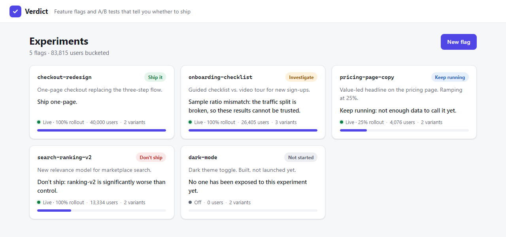
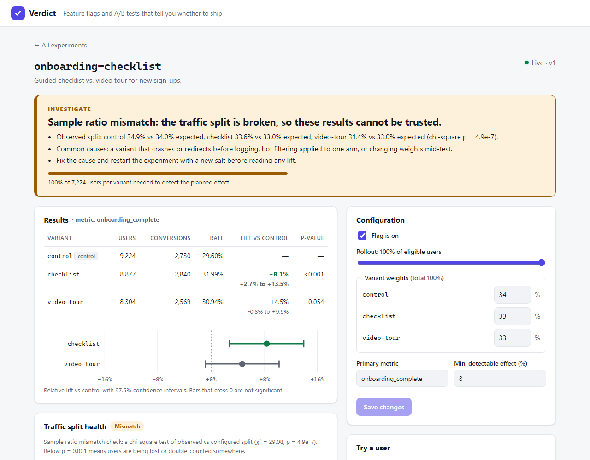
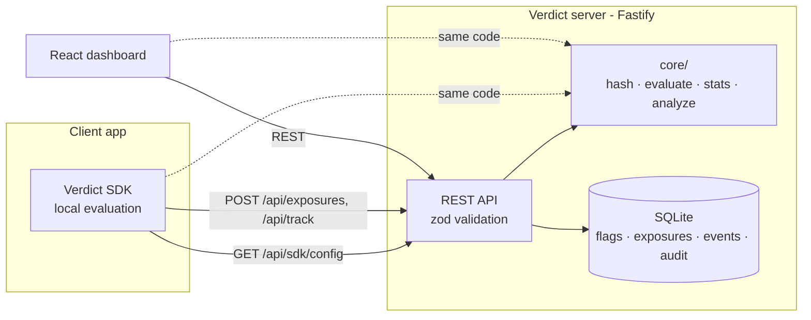

# Verdict

**A self-hosted feature flag and A/B testing platform that tells you whether to ship.**

Most experimentation tools hand you a dashboard of p-values and leave the judgment call to you. Verdict makes the call. It checks whether the experiment can be trusted, whether it has enough data, and whether the result is real, then gives a plain-English verdict: **Ship it**, **Don't ship**, **Keep running**, **No difference**, or **Investigate**.



[](https://github.com/josephfanpm/verdict/actions/workflows/ci.yml)


---

## Why I built this

Running an A/B test means doing three jobs: shipping a flag, getting traffic to the right variant, and deciding what the numbers mean. Teams usually get the first two right and fumble the third:

- **Peeking.** Someone checks the dashboard on day 2, sees p = 0.03, and ships. Run `npm run peeking` to see what that costs: across 2,000 simulated A/A tests (no real difference), checking once yields 5.5% false positives, while checking every 500 users and stopping at the first p < 0.05 yields **25.1%**.
- **Broken splits.** A variant crashes before it logs an exposure, so its users quietly vanish from the data. The test shows a lift that doesn't exist.
- **Mid-test edits.** Someone changes the weights from 50/50 to 90/10 halfway through, which mixes two different populations into one result.

Verdict builds the guardrails for all three into the product, so the safe path is the default one.

## What it does

| | |
|---|---|
| **Feature flags** | On/off, percentage rollouts, attribute targeting (`country in [US, CA]`, `age > 17`), multi-variant splits |
| **Deterministic bucketing** | MurmurHash3 into 10,000 buckets. The same user gets the same variant on every server and in every SDK, with nothing stored |
| **Safe ramp-ups** | Raising a rollout from 10% to 50% only *adds* users; everyone already in keeps their variant |
| **Exposure & event tracking** | First-exposure-wins, and conversions only count if they happen *after* exposure |
| **Statistics** | Two-proportion z-test, delta-method confidence intervals on relative lift, Bonferroni correction for multiple variants, sample size planning |
| **Sample Ratio Mismatch detection** | A chi-square test on every experiment that flags broken traffic splits before anyone reads the lift |
| **Decision engine** | Turns the statistics into a verdict with the reasons spelled out |
| **Change guardrails** | The API refuses edits that would bias a running test (HTTP 409) unless you explicitly restart it |
| **Audit log** | Every change is versioned with a human-readable diff |
| **TypeScript SDK** | Evaluates flags locally with zero network latency and batches exposures in the background |


The screenshot below is the case I care about most. The `checklist` variant shows a statistically significant **+8.1%** lift, and a naive dashboard would say *ship it*. Verdict notices that `video-tour` is missing 1.6 points of its expected traffic (p = 4.9e-7), which means the data is broken, and refuses to call it.



## Quick start

Requires **Node.js 22.13+**. There is no database to install: Verdict uses Node's built-in SQLite.

```bash
git clone https://github.com/josephfanpm/verdict.git
cd verdict
npm install
npm run simulate   # seed 5 demo experiments (~100k simulated users, < 1s)
npm run dev        # API on :3000, dashboard on http://localhost:5173
```

Or run the production build:

```bash
npm run build && npm start   # dashboard + API on http://localhost:3000
```

Or with Docker (seeds the demo automatically):

```bash
docker build -t verdict . && docker run -p 3000:3000 verdict
```

## Architecture



The most important design decision is that **`src/core` is pure TypeScript with no I/O**. The server, the SDK, and the dashboard all import the same hashing, evaluation, and statistics code. A user is bucketed identically whether the server or the SDK makes the decision, and the dashboard's sample size planner runs the exact formula the decision engine uses. This is tested directly: the SDK test asserts that local evaluation matches the server's answer.

```
src/
  core/      Pure domain logic. No dependencies, fully unit-tested.
    hash.ts       MurmurHash3 + bucketing
    evaluate.ts   Targeting, rollout, variant assignment, validation
    stats.ts      Normal/chi-square distributions, z-test, CIs, sample size, SRM
    analyze.ts    Decision engine: counts → verdict + reasons
  server/    Fastify API + SQLite store + demo data generator
  sdk/       Client SDK with local evaluation and batched ingestion
web/         React dashboard (Vite)
test/        49 tests: unit, API integration, SDK end-to-end
```

## How the decision engine works

The verdict is decided in this order, and the order matters:

1. **No exposures** → *Not started*.
2. **Sample ratio mismatch** (chi-square p < 0.001) → *Investigate*. This runs first because when the split is broken, no lift number can be trusted, however good it looks.
3. **A treatment is significantly worse** → *Don't ship*. Harm is acted on early, before the planned sample size is reached, because waiting costs real users.
4. **A treatment is significantly better**
   - and every variant has reached the planned sample size → *Ship it*.
   - but the sample is incomplete → *Keep running*, with a warning about peeking.
5. **No significant difference at full sample** → *No difference*: ship whichever option is cheaper to maintain.
6. Otherwise → *Keep running*, with progress toward the planned sample.

The planned sample size comes from the experiment's **minimum detectable effect** (the smallest lift worth caring about), the control's observed conversion rate, 80% power, and an alpha that is Bonferroni-corrected when there are several treatments.

## Bucketing in detail

```ts
rolloutBucket = murmur3(`${salt}:rollout:${userId}`) % 10_000
variantBucket = murmur3(`${salt}:variant:${userId}`) % 10_000
```

Two **independent** hashes are used. The first decides *whether* a user is in the experiment, and the second decides *which* variant they get. Because they're independent, a ramp-up from 10% to 50% admits new users without reshuffling anyone already enrolled. Each flag has its own salt, so a user's bucket in one experiment says nothing about their bucket in another. Variant boundaries are rounded cumulatively, so a 33.3/33.3/33.3 split still covers all 10,000 buckets.

## API

| Method | Path | Purpose |
|---|---|---|
| `GET` | `/api/flags` | List flags with a verdict summary |
| `POST` | `/api/flags` | Create a flag (starts disabled) |
| `GET` | `/api/flags/:key` | Get a flag |
| `PATCH` | `/api/flags/:key` | Update a flag. Returns **409 `UNSAFE_CHANGE`** if the edit would bias a running test; add `?force=true` to apply it and restart the experiment |
| `GET` | `/api/flags/:key/results` | Full statistical report and verdict |
| `GET` | `/api/flags/:key/audit` | Change history |
| `POST` | `/api/evaluate` | Evaluate a flag for a user and record the exposure (`?dryRun=true` to skip recording) |
| `GET` | `/api/sdk/config` | All flag configs, for local evaluation in the SDK |
| `POST` | `/api/exposures` | Batch-ingest exposures from an SDK |
| `POST` | `/api/track` | Record one conversion event or a batch |

Set `VERDICT_ADMIN_TOKEN` to require `Authorization: Bearer <token>` on flag changes. Evaluation and tracking stay open, as they would be for a client-side SDK key.

```bash
curl -X POST localhost:3000/api/evaluate \
  -H 'content-type: application/json' \
  -d '{"flagKey":"checkout-redesign","user":{"id":"user-42","attributes":{"country":"US"}}}'
# {"flagKey":"checkout-redesign","version":1,"variant":"control","reason":"ASSIGNED","inExperiment":true,"bucket":3123}
```

## SDK

```ts
import { VerdictClient } from './src/sdk';

const verdict = new VerdictClient({ baseUrl: 'https://verdict.example.com' });
await verdict.refresh(); // fetch configs once; evaluation is then local and instant

const user = { id: 'user-42', attributes: { country: 'US', plan: 'pro' } };
if (verdict.variant('checkout-redesign', user) === 'one-page') {
  renderOnePageCheckout();
}

verdict.track('user-42', 'purchase');
await verdict.flush(); // exposures are sent before events, so conversions are never orphaned
```

## Testing

```bash
npm test          # 49 tests in ~1s
npm run typecheck
```

- **Hashing:** verified against the reference MurmurHash3 test vectors, plus a uniformity check across 100,000 users.
- **Statistics:** checked against published normal and chi-square table values and the textbook sample size formula.
- **Evaluation:** determinism, weight accuracy, targeting, ramp-up stability, salt independence.
- **Decision engine:** one test for every verdict branch, including "significant but under-powered" and "great lift but broken split".
- **API:** validation, exposure deduplication, conversion ordering, the 409 guardrail, forced restarts, auth.
- **SDK:** an end-to-end test against a real HTTP server, asserting that local evaluation matches the server.

CI runs typecheck, tests, and the production build on every push.

## Trade-offs and what I'd do next

These are deliberate scope decisions, not oversights:

- **SQLite, not Postgres.** It runs with zero setup, which matters for a project people clone to try. The `Store` class is the only code that touches SQL, so swapping the database means changing one file.
- **Results computed on read.** Fine at demo scale (100k exposures query in milliseconds). At real scale I would pre-aggregate counts per variant per hour.
- **Frequentist fixed-horizon tests.** These are the most widely understood approach, and the peeking guardrail enforces the fixed horizon. The next step would be **sequential testing** (e.g. mSPRT), which allows valid continuous monitoring.
- **Binary conversion metrics only.** Continuous metrics (revenue per user) need a t-test and outlier handling (winsorizing). The event table already stores a `value` for this.
- **Next:** CUPED variance reduction, guardrail metrics (e.g. "ship unless latency regresses"), scheduled ramp-ups, and SDK keys scoped per environment.

## License

MIT
