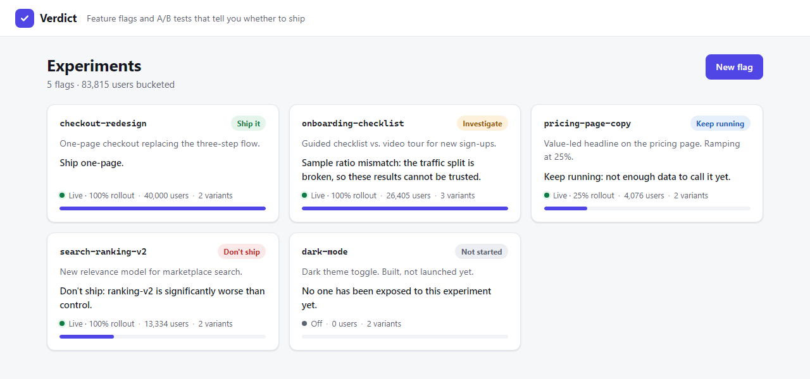
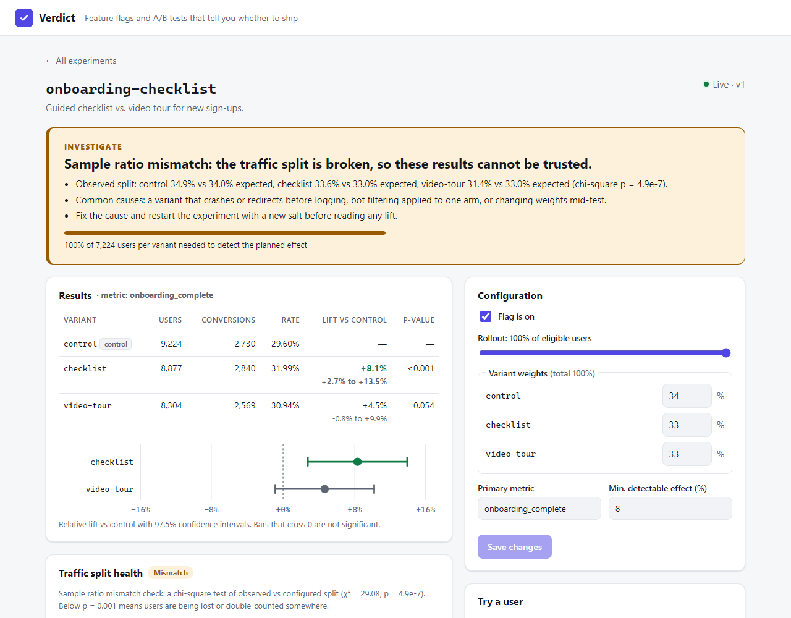

# I built an A/B testing platform that refuses to tell you what you want to hear

If you've worked on a product team, you've probably seen this happen.

An experiment launches on Monday. On Wednesday someone opens the dashboard, sees the new variant up 9% with p = 0.03, and posts a celebration in Slack. The feature ships on Thursday. Three months later, nobody can find the 9% in the revenue numbers.

The dashboard didn't lie, exactly. It answered the question it was asked. The trouble is that "is this p-value below 0.05 right now?" is the wrong question, and most tools are happy to keep answering it.

I'm a product manager. I spend a lot of my time deciding what to build, and experiments are one of the main ways I find out whether I was right. I wanted to understand the machinery underneath them properly, all the way down to the hash function. So I built one: **[Verdict](https://github.com/josephfanpm/verdict)**, a self-hosted feature flag and A/B testing platform whose main job is to make the call for you, including telling you when you can't make one yet.



Each experiment gets one of five verdicts: **Ship it**, **Don't ship**, **Keep running**, **No difference**, or **Investigate**. Every verdict comes with its reasons written out in plain English.

This post covers the three ways experiments usually go wrong, how Verdict guards against each one, and the engineering decisions behind it.

---

## Failure mode 1: Peeking

The Wednesday-afternoon ship is called *peeking*. A p-value threshold of 0.05 promises a 5% false-positive rate, but only if you look **once**, at a sample size you chose in advance. Every extra look is another chance for random noise to cross the line.

I didn't want to take that on faith, so I wrote a simulation. It runs 2,000 A/A tests, where both arms are identical and any "winner" is pure noise, and analyzes them two ways:

```
2,000 A/A tests (no real difference), 10,000 users per arm

Check once at the planned sample:        5.5% false positives
Check every 500 users, stop when p < 0.05: 25.1% false positives
```

Peeking turns a 1-in-20 false-positive rate into roughly **1 in 4**. You can reproduce it with `npm run peeking`.

**How Verdict handles it:** every experiment has a *minimum detectable effect*, the smallest lift worth caring about. From that, plus the control's conversion rate and 80% power, Verdict computes how many users each variant needs:

```ts
export function requiredSampleSize(baselineRate: number, mde: number, alpha = 0.05, power = 0.8): number {
  const p1 = baselineRate;
  const p2 = baselineRate * (1 + mde);
  const zAlpha = normalQuantile(1 - alpha / 2);
  const zBeta = normalQuantile(power);
  const pBar = (p1 + p2) / 2;
  const numerator = zAlpha * Math.sqrt(2 * pBar * (1 - pBar)) + zBeta * Math.sqrt(p1 * (1 - p1) + p2 * (1 - p2));
  return Math.ceil(numerator ** 2 / (p2 - p1) ** 2);
}
```

If a variant looks like a winner before that sample is reached, Verdict says **Keep running** and explains that stopping now inflates the false-positive rate. The test suite has a case for exactly this: a lift that is statistically significant but under-powered must *not* produce a Ship verdict.

There's one deliberate asymmetry. If a variant is significantly **worse**, Verdict says **Don't ship** right away, without waiting for the full sample. Waiting for statistical purity while real users get a broken experience is a bad trade, and that's a product decision as much as a statistical one.

## Failure mode 2: A broken traffic split

This is the one I find most interesting, because the result can look great.

Say you configure a 50/50 split, but the new variant has a bug that crashes the page for some users before the "user saw this" event fires. Those users disappear from the data. The users who remain are disproportionately the ones whose browsers worked fine, and they probably convert better anyway. Your treatment now shows a lift, and that lift is an artifact of who got counted.

This is called a **Sample Ratio Mismatch (SRM)**. The check is a chi-square goodness-of-fit test that compares the observed split against the configured weights. Verdict runs it on every experiment *before* it looks at any lift, because if the split is broken, nothing downstream can be trusted.

The demo data includes this exact scenario. In the `onboarding-checklist` experiment, the `video-tour` variant silently loses 7% of its exposures:



Look at the results table: `checklist` shows a statistically significant **+8.1%** lift. A dashboard that only reported p-values would tell you to ship it. Verdict sees that `video-tour` received 31.4% of traffic when it should have received 33.0%. That's a gap of 1.6 percentage points, which sounds small, but at 26,000 users the chance of it happening randomly is p = 4.9 × 10⁻⁷. The verdict is **Investigate**, along with a list of the usual culprits.

I implemented the chi-square distribution myself (a regularized incomplete gamma function, using the series and continued-fraction methods from *Numerical Recipes*) rather than pulling in a stats library. I wanted every number on the screen traceable to a formula I could explain. The tests check it against published chi-square critical values.

## Failure mode 3: Editing a running experiment

Halfway through a test, someone decides 50/50 is too risky and changes it to 90/10. That sounds reasonable. But the users who arrived in week one were split differently from the users arriving in week two, and week-one users may behave differently from week-two users. The final numbers blend two different experiments into one.

**How Verdict handles it:** the API refuses.

```http
PATCH /api/flags/checkout-redesign
{"variants":[{"key":"control","weight":90},{"key":"one-page","weight":10}]}

409 Conflict
{
  "error": "UNSAFE_CHANGE",
  "message": "This experiment already has 40,000 exposures. Changing variants or weights mid-test
              moves users between arms and causes a sample ratio mismatch. Re-send with
              ?force=true to apply it and restart the experiment."
}
```

You can still make the change, but you have to say so explicitly, and doing so restarts the experiment with a fresh salt and clean data. The dashboard shows this as a warning with an "Apply and restart experiment" button. The safe path is the default, and the unsafe path is a deliberate, logged decision. Every change also goes into a versioned audit log.

Not every change is dangerous, though. *Raising* a rollout from 10% to 50% is safe, and the reason why is the most interesting engineering detail in the project.

---

## Under the hood

### Deterministic bucketing with two independent hashes

Verdict doesn't store "user 42 is in the treatment group." It *computes* it, by hashing the user ID with MurmurHash3 into one of 10,000 buckets. The same input always produces the same bucket, on any server and in any SDK, with no database lookup.

The detail that took me longest to get right: Verdict uses **two independent hashes**.

```ts
const rolloutBucket = bucketFor(`${flag.salt}:rollout:${user.id}`);
if (rolloutBucket >= percentToBuckets(flag.rolloutPercent)) {
  return { variant: flag.defaultVariant, reason: 'OUTSIDE_ROLLOUT', ... };
}
const bucket = bucketFor(`${flag.salt}:variant:${user.id}`);
```

The first hash decides *whether* you're in the experiment. The second decides *which* variant you get. Because they're independent, raising the rollout from 10% to 50% only lets new people in. Everyone already enrolled keeps their bucket and their variant. With a single hash, you'd have to be careful that widening the "in the experiment" range didn't also shift the variant boundaries. There's a test that enrolls 20,000 users at 10%, raises the rollout to 50%, and checks that every originally enrolled user has the same variant afterward.

### One core, three consumers

All the domain logic (hashing, evaluation, statistics, the decision engine) lives in `src/core` as pure TypeScript with no I/O. The Fastify server imports it, the client SDK imports it, and the React dashboard imports it.

As a result, the SDK can evaluate flags locally with zero network latency, and it's guaranteed to agree with the server because it's the same code. An end-to-end test spins up a real HTTP server and asserts exactly that. The sample size planner in the dashboard likewise runs the same function the decision engine uses, so the planner can never disagree with the verdict.

### Counting conversions correctly

Two rules in the data layer prevent subtle bias:

1. **First exposure wins.** The `exposures` table has a primary key on `(flag_key, user_id)`, and inserts use `INSERT OR IGNORE`. A user evaluated 10,000 times is counted once, in one variant.
2. **Conversions must come after exposure.** A purchase someone made *before* seeing the new checkout can't have been caused by it, so the results query only counts events with `ev.ts >= e.ts`.

The second rule caught a real bug in my own SDK. The SDK queued events with the client's timestamp but let the server timestamp exposures when they arrived. Since exposures are flushed in a batch *after* the user acts, every conversion appeared to happen before its exposure and was silently dropped. The fix was to timestamp exposures on the client too, and there's now a test for it.

### A rounding bug worth mentioning

Variant weights are percentages, and buckets are integers. My first version rounded each variant's bucket range separately: a 33.3/33.3/33.3 split became 3,333 + 3,333 + 3,333 = 9,999 buckets. One user in ten thousand fell off the end and hit an "unreachable" error. The fix is to round the *cumulative* boundary instead, so the last boundary is always exactly 10,000. It's a small bug, but it's the kind that only shows up in production at scale, so it now has its own regression test.

---

## Stack and scope

- **TypeScript** (strict) end to end
- **Fastify** API with **zod** request validation
- **SQLite** through Node 22's built-in `node:sqlite` driver, so there's nothing to install. Clone it, run it, done.
- **React + Vite** dashboard, with hand-rolled SVG for the confidence-interval chart
- **Vitest**: 49 tests covering hash test vectors, statistical accuracy, every verdict branch, API guardrails, and SDK end to end
- **GitHub Actions** CI and a **Dockerfile** for one-command deploys

The trade-offs I chose deliberately, and what I'd build next:

- **SQLite instead of Postgres**, because zero setup matters for a project people want to try. All SQL lives in one `Store` class, so swapping the database touches one file.
- **Results computed on read.** That's fine for 100k exposures (milliseconds); at real scale I'd pre-aggregate.
- **Fixed-horizon tests.** These are the most widely understood approach, and the peeking guardrail enforces the horizon. The natural next step is **sequential testing** (such as mSPRT), which makes continuous monitoring statistically valid.
- **Binary metrics only.** Revenue-per-user needs a t-test and outlier handling. The schema already stores event values for it.

## What building it taught me as a PM

**The hard part of an experimentation platform isn't the statistics. It's choosing defaults.** The math for a z-test fits on an index card. The decisions that took real thought were product decisions: should harm short-circuit the sample size requirement? Should an unsafe edit be blocked, or warned about? Should SRM override a significant result? Each of those is a judgment about which mistake is more expensive, and I'm now a lot more opinionated about each one.

**Making the tool say "I don't know yet" is a feature.** "Keep running: 23% of the planned sample" is less satisfying than a green checkmark, but it's the answer that protects the team from shipping noise.

**Tests are a spec.** Writing `it('says KEEP_RUNNING for an early win, to avoid peeking')` forced me to state the product rule precisely before any code existed. That felt a lot like writing acceptance criteria, which is the part of PM work I already do every day.

## How I built it

I built Verdict with an AI coding agent (Claude Code) as a pair programmer. I set the product direction: the problem, the guardrails, the order of operations in the decision engine, and the bar that every statistical claim had to be tested against a published reference value. Then I reviewed, questioned, and tested the implementation until I could explain every line. I think this is how a lot of software will get built, and I wanted to get good at doing it rigorously, not just quickly.

## Try it

```bash
git clone https://github.com/josephfanpm/verdict.git
cd verdict && npm install
npm run simulate   # 5 demo experiments, ~100k simulated users, < 1 second
npm run dev        # http://localhost:5173
```

The code is on GitHub at **[josephfanpm/verdict](https://github.com/josephfanpm/verdict)**. If you work on experimentation and think I made the wrong call on one of those defaults, I'd genuinely like to hear the argument.
